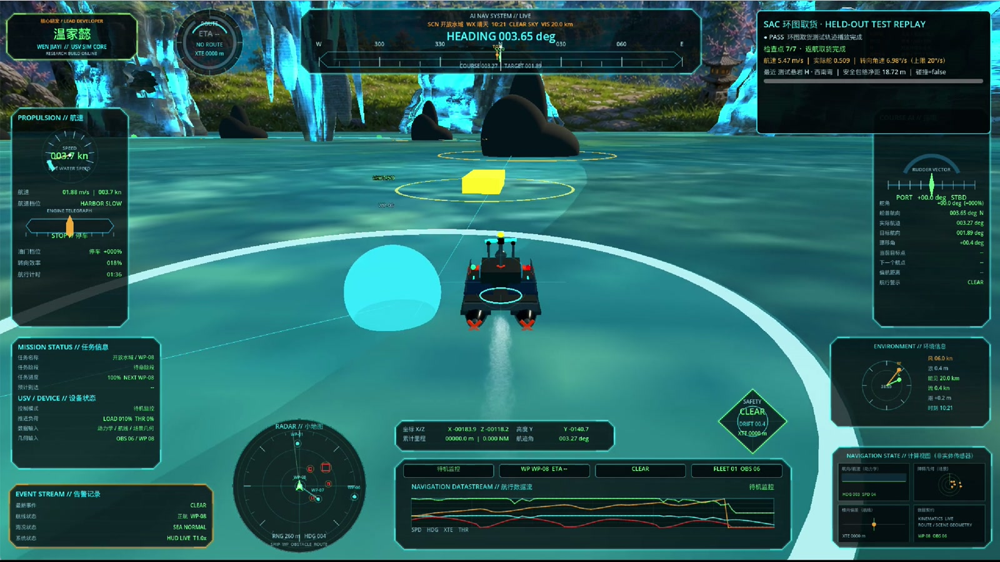
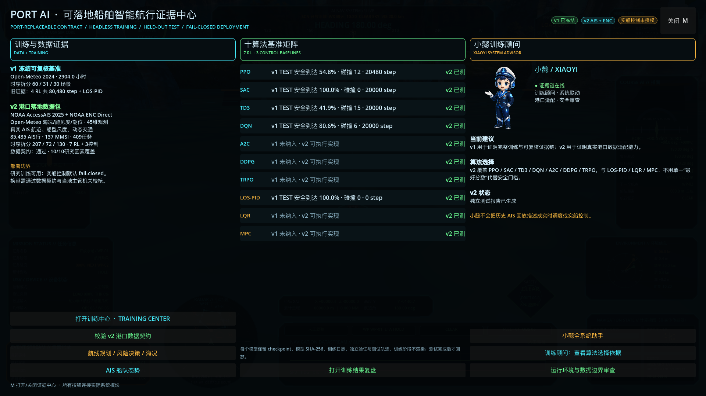
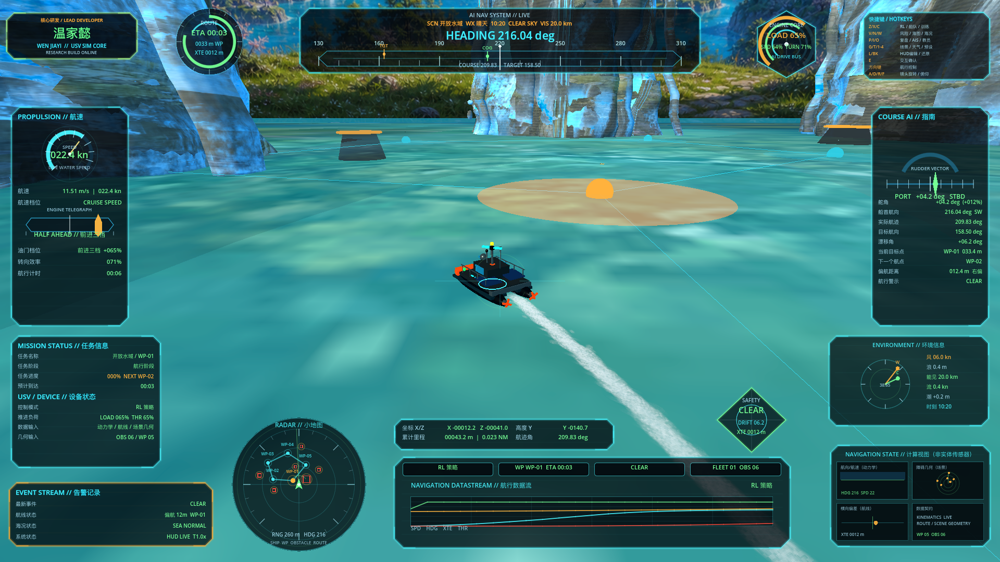
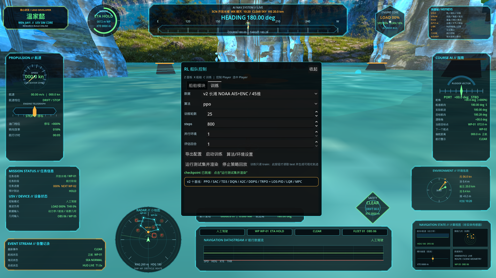
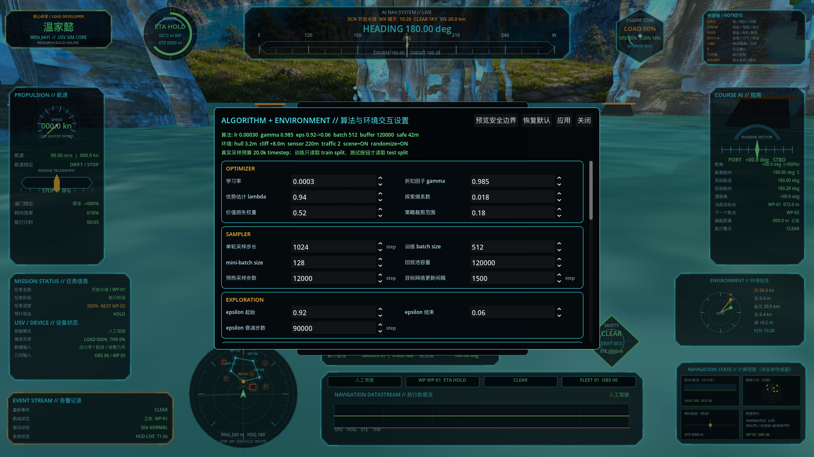
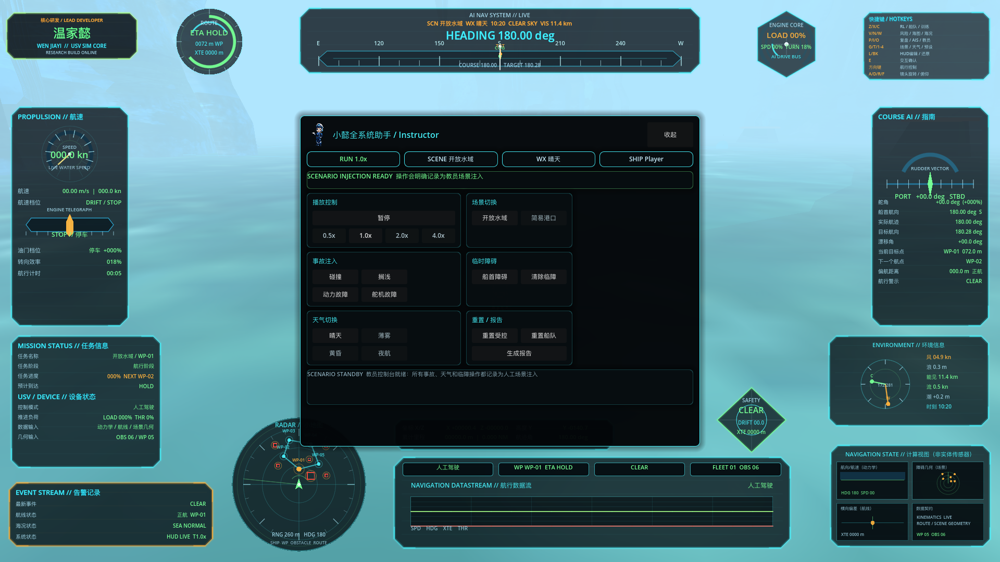

<p align="center">
  
</p>

<h2 align="center">实际策略渲染视频 / Real Policy Rendering</h2>

<p align="center">
  <a href="docs/media/cargo-circuit-sac-heldout-test.mp4">
    
  </a>
  <br />
  <strong>▶ 点击画面播放完整 71 秒无声视频 / Click the image to play the full 71-second silent video</strong>
  <br />
  <sub>SAC-S1 · 36维连续控制 · 300,000 timestep · held-out test · 7/7检查点 · 零碰撞 · 返航取货完成。视频来自真实 Godot 测试轨迹回放；外部录音已全部移除。</sub>
</p>

<p align="center">
  <a href="https://github.com/wenjiayi123/sailing-simulator/actions/workflows/rl-tests.yml"></a>
  <a href="LICENSE"></a>
  
  
  
  
</p>

<p align="center">
  <strong>不是“船在场景里会动”，而是一套可训练、可拒绝、可回放、可追溯的自主航行策略准入实验台。</strong><br />
  <em>Not merely a moving vessel—a trainable, rejectable, replayable, and traceable admission bench for autonomous-navigation policies.</em>
</p>

<p align="center">
  <strong>研发作者：</strong>温家懿 · <strong>Research Author:</strong> Wen Jiayi
</p>

<p align="center">
  <a href="#系统价值--engineering-value">系统价值</a> ·
  <a href="#真实港口十算法覆盖基准--real-port-ten-method-coverage-benchmark">十算法矩阵</a> ·
  <a href="#固定公开海况可靠性基准--public-forcing-reliability-benchmark">可靠性基准</a> ·
  <a href="#训练与渲染边界--training--rendering-boundary">训练边界</a> ·
  <a href="#快速开始--quick-start">快速开始</a> ·
  <a href="reports/simulator_reliability_audit_v1.md">证据报告</a>
</p>

---

## 同屏证据与真实联动 / Evidence-first UI

<p align="center">
  
</p>

证据中心不是静态海报：按钮分别调用训练中心、航线规划/风险/海况、AIS、结果复盘和小懿全系统助手；自动验收同时验证对应快捷键与主船人工/后端控制航行。

## 系统价值 / Engineering value

Godot 4.7 负责船舶操控、港区环境、风险包络和三维证据回放；Python/Gymnasium 负责时间隔离数据集、无渲染训练、模型固化、独立测试和策略准入。训练进度直接来自 Stable-Baselines3 的实际 `num_timesteps`，测试轨迹只由训练完成后的封存 `test` rollout 生成；失败、碰撞、近失和越界不会被演示层改写。

Godot 4.7 owns vessel control, port geometry, risk envelopes, and 3D evidence replay. Python and Gymnasium own chronological data isolation, headless learning, model persistence, independent evaluation, and policy admission. Training progress comes from actual Stable-Baselines3 timesteps, while visual replay is generated only from sealed post-training test rollouts.

| 可核验维度 / Verifiable dimension | 固定证据 / Pinned evidence | 工程意义 / Why it matters |
|---|---:|---|
| 场景合同 / Scenario contracts | <strong>121/121</strong> 完整<br><sub><strong>121/121</strong> complete</sub> | 航线、障碍、地形、动态船与风浪流字段可逐场检查<br><sub>Routes, obstacles, terrain, traffic vessels, and wind–wave–current fields are inspectable per scenario.</sub> |
| 训练执行 / Training execution | <strong>80,480</strong> RL环境步、<strong>167</strong> episodes<br><sub><strong>80,480</strong> RL steps and <strong>167</strong> episodes</sub> | 真实 learner 路径，不用计时器模拟进度<br><sub>Real learner execution; no timer-driven progress simulation.</sub> |
| 独立评测 / Independent evaluation | <strong>155</strong> validation + <strong>150</strong> final rollouts | 训练、选型与最终测试严格分离<br><sub>Training, model selection, and final testing remain strictly separated.</sub> |
| 回放一致性 / Replay consistency | <strong>5/5</strong> 回放、<strong>1,723</strong> 采样点<br><sub><strong>5/5</strong> replays and <strong>1,723</strong> samples</sub> | 后端指标、逐场CSV与Godot轨迹相互校验<br><sub>Backend metrics, per-scenario CSV files, and Godot trajectories cross-check one another.</sub> |
| 证据门禁 / Evidence gate | <strong>28/28</strong> 检查通过<br><sub><strong>28/28</strong> checks passed</sub> | 数据、奖励、模型、轨迹与源码哈希绑定<br><sub>Dataset, reward, model, trajectory, and source hashes are bound together.</sub> |
| 安全准入 / Safety admission | 五方法均被保守门禁拒绝<br><sub>All five methods rejected by the conservative gate</sub> | 证明系统会暴露安全裕度缺口，而非美化零碰撞<br><sub>The platform exposes safety-margin deficiencies instead of polishing a zero-collision result.</sub> |

<p align="center">
  
  <br /><sub>晴天航行运行态：真实油门/舵角输入、航迹尾流、目标航线、雷达、风险状态和遥测同屏。</sub>
</p>

### 环航取货 RL：技术审阅入口 / Curated cargo-circuit RL evidence

为便于技术面试核验，仓库公开了实际运行的 [36维连续控制环境](tools/cargo_rl/environment.py)、[44维动态交通与Residual SAC环境](tools/cargo_rl/dynamic_environment.py)、[七算法训练/留出评测实现](tools/cargo_rl/trainer.py)、[训练命令入口](tools/cargo_rl_train.py)、[Godot取货回放控制器](examples/cargo_circuit_godot/cargo_circuit_replay_controller.gd)、[H总控面板](examples/cargo_circuit_godot/cargo_circuit_rl_panel.gd)、[脱敏证据清单](reports/cargo_circuit_public_evidence_v1.json)及[自动合同测试](tests/test_cargo_circuit_public_evidence.py)。静态SAC-S1完成30万步无渲染训练；动态RES-SAC-D2在冻结静态策略上融合相对运动、TCPA/DCPA和6艘移动交通船。两者在各自固定留出任务中均完成7/7检查点和取货且零碰撞，完整口径见[技术证据说明](docs/CARGO_RL_TECHNICAL_EVIDENCE.md)。

This remains a curated verification surface rather than a full project dump. The environment, trainer, CLI, demonstration logic, replay controller, and control-panel source are reviewable; exact map geometry, frozen experiment configuration, model weights, per-step trajectories, and the complete Godot scene/visual package remain private. Frozen SHA-256 commitments bind the demonstrated artifacts without publishing those withheld files.

> [!IMPORTANT]
> 当前证据证明的是仿真平台完整性、算法评测能力和失效安全门禁，不是实船海试、COLREGs认证或商业航行许可。公开环境强迫、仿真动力学与真实传感/执行数据始终分层标注。
>
> The evidence demonstrates simulator integrity, algorithm-evaluation capability, and fail-closed admission—not sea-trial performance, COLREGs certification, or commercial navigation authorization. Public environmental forcing, simulated dynamics, and real sensing/actuation data are always labelled as distinct evidence layers.

## 真实港口十算法覆盖基准 / Real-port ten-method coverage benchmark

v2 在不改写 v1 已冻结模型和指标的前提下，新增 `ship_port_dataset_v3` 港口数据契约与 45 维港口环境。数据包由 NOAA 2025-01-01 至 2025-01-07 七个全国 AccessAIS 日档流式筛选构建，叠加 NOAA ENC Direct 派生岸线/固定危险/水深/航道/限制区/TSS，以及同期 Open-Meteo 风、浪、流、能见度和模式海平面。

The v2 benchmark adds a `ship_port_dataset_v3` contract and a 45-dimensional port environment without rewriting any frozen v1 model or metric. It streams seven nationwide NOAA AccessAIS daily archives from 1–7 January 2025 and combines the retained tracks with derived NOAA ENC geometry and co-temporal Open-Meteo forcing.

| 可核验项 | v2 固定数据 |
|---|---:|
| NOAA 原档扫描规模 | **47,958,624** 行 / **1.335 GB** 压缩数据 |
| 港区 AIS 运动记录 | **85,435** |
| 真实航迹任务 | **409**（207 train / 72 validation / 130 test） |
| 任务内唯一 MMSI | **137** |
| 航迹点 / 动态目标实例 | **2,280 / 646** |
| ENC 派生几何 | 11 地形、50 固定障碍、32 水深区、12 航道、3 限制区、1 TSS |
| 任务字段覆盖 | 船长/船宽/吃水/风浪流/能见度/潮位/速度代理均 **100%** |
| 算法 | **7 RL + 3 control** |

<p align="center">
  
  <br /><sub>训练中心：v2 NOAA AIS + ENC 数据档、45 维环境和 7 RL + 3 控制后端在同一真实入口中选择。</sub>
</p>

| 方法 | 类型 | 动作空间 | 实现 |
|---|---|---|---|
| PPO / SAC / TD3 | RL | 连续油门 + 舵角 | Stable-Baselines3 |
| DQN | RL | 9 个离散油门/舵角组合 | Stable-Baselines3 |
| A2C / DDPG | RL | 连续油门 + 舵角 | Stable-Baselines3 |
| TRPO | RL | 连续油门 + 舵角 | sb3-contrib |
| LOS-PID | 控制 | 连续油门 + 舵角 | 视线制导 + PID |
| LQR | 控制 | 连续油门 + 舵角 | 三状态离散 LQR / DARE |
| MPC | 控制 | 连续油门 + 舵角 | 8 步滚动时域低阶运动学优化 |

45 维观测覆盖相对目标与航向、速度/油门/舵角、障碍扇区、闭合速度、TCPA/DCPA、风浪流、边界/XTE，以及能见度、潮位、水深、UKC、航道、速度余量、船型尺度、会遇类型、让路责任和交通密度。目标函数同时记录推进、航向、经济航速、碰撞、搁浅、净距、航道、超速与保守 COLREG 会遇代理。完整字段、适配步骤和未上线因素见 [港口替换与上线门禁](docs/PORT_ADAPTER_GUIDE.md)。

<p align="center">
  
  <br /><sub>算法与环境交互设置：优化器、采样器、探索预算、船体/悬岩净距、感知范围和动态交通参数均映射到真实后端配置。</sub>
</p>

> [!NOTE]
> v2 的 2,000 步/算法运行是“公开数据与全算法执行覆盖”证据，不宣称七个 RL 已收敛。历史 AIS 不是实时交通，ENC Direct 不是船载认证海图；VTS、引航/拖轮/泊位、实时传感、船型标定和认证控制链未验证时，`live_control_ready=false`。

十方法已完整完成 **720 个 validation + 1,300 个 sealed test rollout**，覆盖完整性为 **PASS**，安全准入为 **FAIL-CLOSED**。LOS-PID/LQR/MPC 在 130 场 test 的无碰撞到达率分别为 **86.9% / 70.0% / 73.8%**，但碰撞场景率仍为 **13.1% / 18.5% / 16.9%**，因此不以较高到达率替代安全结论。逐方法完整指标、哈希和边界见 [v2 十方法报告](reports/port_ops_benchmark_v2.md) 与 [机器可读报告](reports/port_ops_benchmark_v2.json)。

## v1 五种冻结基线 / Frozen v1 five-method benchmark

| 基线 / Baseline | 动作空间 / Action space | 实现 / Implementation |
|---|---|---|
| PPO | 连续油门 + 舵角<br><sub>Continuous throttle + rudder</sub> | Stable-Baselines3 |
| SAC | 连续油门 + 舵角<br><sub>Continuous throttle + rudder</sub> | Stable-Baselines3 |
| TD3 | 连续油门 + 舵角<br><sub>Continuous throttle + rudder</sub> | Stable-Baselines3 |
| DQN | 9 个离散油门/舵角组合<br><sub>Nine discrete throttle/rudder combinations</sub> | Stable-Baselines3 |
| LOS-PID | 连续油门 + 舵角<br><sub>Continuous throttle + rudder</sub> | 视线制导 + PID 控制理论基线<br><sub>Line-of-sight guidance with a PID control-theory baseline</sub> |

DQN 只使用离散动作，因为标准 DQN 本身不支持连续动作。四种 RL 与 LOS-PID 使用同一观测定义、动力学、奖励/安全指标和数据集切分，便于做可复现实验。

Standard DQN is restricted to discrete actions because it does not natively support continuous control. The four RL methods and LOS-PID share the same observation definition, dynamics, reward/safety metrics, and dataset splits for reproducible comparison.

数值环境不是二维圆点演示：训练会计算圆形、矩形和多边形障碍，区分悬岩/岸线的额外安全净距，推进动态交通船，并把闭合速度、TCPA/DCPA、动态目标标识、边界净距、前/左/右扇区净距及风浪流相对方向纳入 28 维观测。风、浪、流均实际进入状态转移；当前 Godot 场景中的 `落水悬岩`、导航岩石和临时港区障碍可随训练配置一起合并。

The numerical environment is not a two-dimensional point demo. It evaluates circular, rectangular, and polygonal obstacles; applies additional clearance to overhangs and shorelines; advances dynamic traffic vessels; and incorporates closing speed, TCPA/DCPA, target identity, boundary clearance, forward/port/starboard sector clearance, and relative wind–wave–current directions into a 28-dimensional observation. Wind, waves, and current affect state transitions, while the Godot scene’s `落水悬岩` overhangs, navigation rocks, and temporary port obstacles can be merged into each training configuration.

## 固定公开海况可靠性基准 / Public-forcing reliability benchmark

本项目以模拟器的功能闭环和可靠性为评价对象，不把离线仿真结果包装成港口降本、增收或实船安全收益。

The benchmark evaluates simulator completeness and reliability; it does not present offline simulation results as port cost savings, revenue growth, or proven vessel-safety benefits.

- <strong>环境输入 / Environmental input：</strong>Open-Meteo 长滩邻近水域 2024-01-01 至 2024-04-30 共 2,904 条小时级再分析/模式归档，派生 121 个日级场景。<br>
  <strong>EN:</strong> 2,904 hourly reanalysis/model archive records for waters near Long Beach from 1 January through 30 April 2024, transformed into 121 daily scenarios.
- <strong>时间隔离 / Temporal isolation：</strong>1—2 月 60 场训练、3 月 31 场验证、4 月 30 场最终测试；不随机打乱日期。<br>
  <strong>EN:</strong> 60 January–February training scenarios, 31 March validation scenarios, and 30 April sealed-test scenarios, with no randomized dates.
- <strong>训练预算 / Training budget：</strong>PPO、SAC、TD3、DQN 各设置 20,000 timestep，LOS-PID 为同环境控制理论基线。<br>
  <strong>EN:</strong> 20,000 timesteps are configured for each of PPO, SAC, TD3, and DQN; LOS-PID is the control-theory baseline in the same environment.
- <strong>最终验证 / Final evaluation：</strong>五方法共 150 个方法-场景 rollout。SAC 与 LOS-PID 在各自 30 场测试中实现 100% <strong>无碰撞到达</strong>且碰撞场景率为 0；SAC 平均/P95 最大横向航迹误差为 9.98/15.13 m，但 P05 最小净距仅 0.99 m。<br>
  <strong>EN:</strong> The five methods complete 150 method-scenario rollouts. SAC and LOS-PID achieve 100% <strong>collision-free arrival</strong> and zero collision scenarios across their respective 30 tests. SAC’s mean/P95 maximum cross-track error is 9.98/15.13 m, while its P05 minimum clearance is only 0.99 m.
- <strong>安全语义 / Safety semantics：</strong>旧字段 `safe_completion_rate` 不排除近失事件，因此只能解释为“无碰撞到达率”。当前五方法在 32 m 风险包络下均触发过包络侵入，保守离线策略准入门禁拒绝全部方法，不把零碰撞包装成安全认证。<br>
  <strong>EN:</strong> The legacy `safe_completion_rate` field does not exclude near misses and therefore means only “collision-free arrival rate.” Every method enters the 32 m risk envelope at least once, so the conservative offline admission gate rejects all five instead of treating zero collision as safety certification.
- <strong>工程验收 / Engineering acceptance：</strong>121/121 场景契约完整，150/150 逐场记录齐全，28/28 项哈希与指标一致性检查、5/5 份代表性 Godot 回放（1,723 个采样点）及 Godot 4.7 解析/短时 headless 启动 2/2 通过。<br>
  <strong>EN:</strong> 121/121 scenario contracts and 150/150 per-scenario records are complete; 28/28 hash/metric checks, 5/5 representative Godot replays (1,723 samples), and 2/2 Godot 4.7 parse/short headless-start checks pass.
- <strong>证据边界 / Evidence boundary：</strong>海况来自公开数值产品，航线、障碍、船舶动力学和动作响应来自项目仿真设定；结果不是实船海试、避碰认证或 COLREGs 合规结论。<br>
  <strong>EN:</strong> Environmental forcing comes from public numerical products, whereas routes, obstacles, vessel dynamics, and action response come from project simulation settings. The result is not a sea trial, collision-avoidance certification, or COLREGs compliance finding.

完整方法、逐算法结果、哈希和边界见 [模拟器可靠性审计](reports/simulator_reliability_audit_v1.md)、[机器可读审计](reports/simulator_reliability_audit_v1.json) 与 [五方法原始基准](reports/navigation_benchmark_v1.json)。

See the [simulator reliability audit](reports/simulator_reliability_audit_v1.md), [machine-readable audit](reports/simulator_reliability_audit_v1.json), and [raw five-method benchmark](reports/navigation_benchmark_v1.json) for the complete protocol, per-method results, hashes, and evidence boundaries.

## 训练与渲染边界 / Training & rendering boundary

```text
train split -> Python 数值环境 / numerical environment -> 真实训练 / real training -> checkpoint
                                                   |
用户点击“运行测试集并渲染” / user starts held-out rendering
                                                   v
test split  -> Python 确定性 rollout / deterministic rollout
            -> 真实轨迹/指标 / recorded trajectory and metrics -> Godot 3D 回放 / replay
```

- 训练进程不启动 Godot 场景渲染。<br>
  *The training process never starts Godot scene rendering.*
- 训练阶段只实例化 `train` split。<br>
  *Only the `train` split is instantiated during learning.*
- checkpoint 同时记录数据集和完整实验配置 SHA-256；训练后数据、船体动力、奖励或环境安全设置被替换时，测试会拒绝运行。<br>
  *Each checkpoint records SHA-256 for both the dataset and the complete experiment configuration. Evaluation refuses to run if data, vessel dynamics, reward, or environmental safety settings change after training.*
- 测试失败、碰撞、超时和航线误差不会被改写。<br>
  *Failures, collisions, timeouts, and route errors are never rewritten by the presentation layer.*
- Godot 回放使用测试 rollout 记录的油门/舵角序列，而不是内置演示路线。<br>
  *Godot replay consumes the throttle/rudder sequence captured by the test rollout, not a built-in demonstration route.*

## 快速开始 / Quick start

安装 Python 训练环境：<br>
Install the Python training environment:

```bash
cd /path/to/sailing-simulator
bash tools/setup_rl_env.sh
```

默认开发、测试和 CI 使用 `requirements-rl.txt`。只有对仓库自带、SHA-256
校验通过的历史模型进行字节级深度复算时，才使用报告保存的旧环境记录。<br>
Development, tests, and CI use `requirements-rl.txt`. Use the recorded legacy environment only for byte-level deep recomputation of repository-bundled historical models whose SHA-256 hashes have already been verified:

```bash
.venv/bin/python -m pip install -r reports/navigation_benchmark_runtime_legacy.lock
```

旧环境记录不是默认运行依赖，不应用于加载外部或未经哈希校验的模型文件。<br>
The legacy environment is not a default runtime dependency and must not load external or unhashed model files.

运行测试：<br>
Run the verification gates:

```bash
make test
make benchmark-verify
make reliability-audit
make release-check
```

GitHub Actions 会在 push 和 pull request 上运行环境契约、split 隔离、LOS-PID 闭环、AIS 转换、公开数据完整性、实验哈希和报告一致性检查。贡献数据或算法前请阅读 [CONTRIBUTING.md](CONTRIBUTING.md)。<br>
On every push and pull request, GitHub Actions verifies the environment contract, split isolation, LOS-PID loop, AIS conversion, public-data integrity, experiment hashes, and report consistency. Read [CONTRIBUTING.md](CONTRIBUTING.md) before contributing data or algorithms.

打开 Godot：<br>
Open the project in Godot:

```bash
/path/to/Godot --editor --path /path/to/sailing-simulator
```

运行主场景后按 `C` 打开训练页。“算法/环境设置”可配置船体半径、悬岩净距、感知范围、碰撞时间窗、域随机化和生成交通船；“预览安全边界”会把有效包络直接画回场景。选择算法和预算后点击“启动训练”，完成后再点击“运行测试集并渲染”。<br>
Run the main scene and press `C` to open the training page. “Algorithm / Environment Settings” configures hull radius, overhang clearance, sensing range, collision horizon, domain randomization, and generated traffic. “Preview Safety Boundary” draws the effective envelope into the scene. Select an algorithm and budget, start training, and only after completion run the held-out test set with rendering.

<p align="center">
  
  <br /><sub>小懿全系统助手：场景、天气、事故、临时障碍、播放速度、重置与报告按钮均调用实际系统模块。</sub>
</p>

### 前端按钮与快捷键 / UI linkage and hotkeys

| 键 | 实际模块 | 同屏按钮入口 |
|---|---|---|
| `M` | 可落地证据中心 | 主入口；可继续打开训练、航线/风险/海况、AIS、复盘与小懿助手 |
| `Z` / `X` / `C` | RL 控制台 / 船队页 / 训练中心 | 证据中心“打开训练中心” |
| `N` | 航线规划 | “航线规划 / 风险决策 / 海况” |
| `V` | 风险与策略准入 | “航线规划 / 风险决策 / 海况” |
| `W` | 风浪流与能见度 | “航线规划 / 风险决策 / 海况” |
| `I` | AIS 船队态势 | “AIS 船队态势” |
| `P` | 仿真/训练结果复盘 | “打开训练结果复盘” |
| `O` | 小懿全系统助手 | “小懿全系统助手” |
| `G` / `K` / `T` | 场景切换 / 测试轨迹回放 / 昼夜天气循环 | 主 HUD 快捷键提示 |

主船使用方向键产生航行输入，`A/D` 环绕相机、`R/F` 调整俯仰。发布门禁会加载真实 `main.tscn`，检查十个核心 UI 字母键、所有证据中心按钮连接、十算法前端/后端清单，并分别通过后端指令与方向键驱动主船。当前自动冒烟 **36/36** 通过；结果写入 `reports/godot_ui_navigation_smoke_v1.json`。

## 命令行训练 / Command-line training

```bash
.venv/bin/python tools/rl_train_baselines.py \
  --mode train \
  --algorithm ppo \
  --config tests/fixtures/ship_training_config.json \
  --episodes 25 \
  --steps 800 \
  --agents 1 \
  --output-dir output/rl_runs \
  --progress-json output/rl_runs/training_progress.json \
  --checkpoint-json output/rl_runs/policy_checkpoint.json
```

训练后独立测试：<br>
Evaluate independently after training:

```bash
.venv/bin/python tools/rl_train_baselines.py \
  --mode evaluate \
  --algorithm ppo \
  --config tests/fixtures/ship_training_config.json \
  --steps 800 \
  --eval-episodes 1 \
  --output-dir output/rl_runs \
  --progress-json output/rl_runs/evaluation_progress.json \
  --checkpoint-json output/rl_runs/policy_checkpoint.json \
  --trajectory-json output/rl_runs/policy_test_trajectory.json
```

固定基准的复现入口：<br>
Reproduce the pinned benchmark:

```bash
# 离线重建121个场景 / rebuild 121 scenarios from the bundled 2,904 hourly records
.venv/bin/python tools/build_public_navigation_benchmark.py

# 快速哈希核验 / quickly verify data, config, code, model, and trajectory hashes
.venv/bin/python tools/run_navigation_benchmark.py verify

# 深度复算 / rerun 150 deterministic sealed-test rollouts across five methods
.venv/bin/python tools/run_navigation_benchmark.py verify --deep

# v2 十方法报告与港口契约核验 / verify the v2 ten-method port benchmark
make port-contract-verify
make port-benchmark-verify

# Godot 前端联动与主船航行回归 / UI linkage and navigation regression
make godot-ui-navigation-smoke \
  GODOT=/absolute/path/to/Godot
```

## 接入真实港口 / Bring your own port

项目接受包含 `train`、`validation`、`test` 的 `ship_port_dataset_v3` JSON。复制 [港口包清单模板](data/ports/port_package_manifest_v3.example.json)，对齐历史 AIS、授权水深/航道/限制区 GIS 与逐小时环境输入，通过契约后只需让实验 JSON 指向新数据包，无需修改十种算法代码。<br>
The platform accepts a `ship_port_dataset_v3` JSON contract with chronological `train`, `validation`, and `test` splits. Fill the [port package manifest](data/ports/port_package_manifest_v3.example.json), align AIS, authorized chart/GIS layers, and hourly forcing, then point an experiment file at the new package without modifying any of the ten algorithms:

```bash
.venv/bin/python tools/validate_port_package.py \
  /absolute/path/to/port_dataset.json \
  --require-research-ready \
  --report /absolute/path/to/port_contract_report.json

SHIP_PORT_EXPERIMENT=/absolute/path/to/experiment.json godot --path .
```

NOAA/BOEM AccessAIS CSV 或 ZIP 可直接规范化：<br>
Normalize a NOAA/BOEM AccessAIS CSV or ZIP directly:

```bash
python3 tools/public_data_pipeline.py ais \
  --input /path/to/AccessAIS-export.zip \
  --origin-lat 33.73 \
  --origin-lon -118.27 \
  --bbox -118.35 33.68 -118.15 33.82 \
  --environment-geojson /path/to/port_environment.geojson \
  --dataset-output /path/to/port_training_dataset.json \
  --targets-output /path/to/ais_targets.json
```

AIS 态势面板读取：<br>
Feed the AIS situational-awareness panel:

```bash
export SHIP_AIS_TARGETS=/absolute/path/to/ais_targets.json
```

AIS 提供历史航迹，GeoJSON 提供岸线、悬岩、礁石、码头和防波堤；二者会投影到同一个局部米制坐标系。港口场景配置可通过 `SHIP_PORT_PROFILE` 或 `user://port_profile.json` 替换。RL 测试回放直接读取测试任务中的航线、地形、静态障碍和动态交通，因此换训练集/测试集即可更换算法实验水域。<br>
AIS supplies historical tracks, while GeoJSON supplies shorelines, overhangs, reefs, berths, and breakwaters; both are projected into the same local metric coordinate system. Replace the port profile through `SHIP_PORT_PROFILE` or `user://port_profile.json`. RL test replay reads routes, terrain, static obstacles, and dynamic traffic directly from the test task, so changing the train/test dataset changes the experimental waterway.

## 公开海况数据 / Public environmental data

默认启动会读取仓库内带来源元数据的 Open-Meteo 新加坡水域快照，并异步刷新实时公开数据。气象面板会显示 `live`、`cache`、`manual` 等真实来源状态；点击天气预设或手动改数值后，来源会明确变成 `scenario_override`/`manual_override`。<br>
By default the project reads the bundled provenance-tagged Open-Meteo snapshot for Singapore waters and refreshes public live data asynchronously. The weather panel exposes source states such as `live`, `cache`, and `manual`; selecting a preset or editing a value explicitly changes provenance to `scenario_override` or `manual_override`.

固定可靠性基准则使用长滩邻近水域 2024 年 1—4 月归档数据，不依赖启动时的网络状态。`data/public/*.provenance.json` 保留请求 URL、许可、抓取时间和小时 CSV SHA-256。Open-Meteo 的数值产品只作为离线环境强迫，不用于实际沿海导航。<br>
The pinned reliability benchmark uses archived January–April 2024 records near Long Beach and does not depend on network availability at launch. `data/public/*.provenance.json` preserves the request URL, license, retrieval timestamp, and hourly CSV SHA-256. Open-Meteo numerical products are offline forcing only, never a source for real coastal navigation.

也可离线更新缓存：<br>
Refresh the cache offline:

```bash
python3 tools/public_data_pipeline.py weather \
  --latitude 1.2644 \
  --longitude 103.8223 \
  --output data/public_cache/marine_weather_singapore.json
```

## 关键目录 / Key directories

- `tools/ship_rl/`：v1/v2 Gymnasium 环境、十算法训练/控制和测试。<br>
  *v1/v2 Gymnasium environments plus ten-method RL/control evaluation.*
- `tools/rl_train_baselines.py`：Godot 与命令行共用入口。<br>
  *Shared entry point for Godot and command-line workflows.*
- `data/rl/long_beach_public_weather_benchmark_v1.json`：固定公开海况可靠性基准，明确区分公开环境输入与仿真场景。<br>
  *Pinned public-forcing benchmark that separates public environmental input from simulated scenarios.*
- `data/rl/default_port_dataset.json`：安装级项目原生 smoke fixture，不冒充实测 AIS。<br>
  *Installation-level native smoke fixture; never represented as measured AIS.*
- `tools/public_data_pipeline.py`：公开气象和 NOAA AIS 数据适配器。<br>
  *Adapters for public weather and NOAA AIS data.*
- `tools/run_navigation_benchmark.py`：五方法准备、冻结测试集、最终测试和深度复核。<br>
  *Five-method preparation, test sealing, final evaluation, and deep verification.*
- `tools/run_port_ops_benchmark.py`：十方法真实港口数据覆盖测试、冻结测试集与哈希复核。<br>
  *Ten-method real-port data coverage, sealed-test evaluation, and hash verification.*
- `tools/run_simulator_reliability_audit.py`：场景覆盖、逐场指标、回放一致性、证据完整性和控制策略准入双门禁。<br>
  *Dual reliability/admission gate for coverage, per-scenario metrics, replay consistency, and evidence integrity.*
- `tools/run_godot_acceptance.py`：Godot 版本、解析和短时 headless 启动验收，回执绑定脚本/场景源文件树。<br>
  *Godot version, parse, and short headless-start acceptance bound to the script/scene source tree.*
- `tools/release_check.py`：数据、模型、轨迹、报告和开源边界门禁。<br>
  *Release gate for data, models, trajectories, reports, and open-source boundaries.*
- `scripts/ui/ship_rl_control_panel.gd`：真实训练/测试任务控制台。<br>
  *Console for real training and evaluation jobs.*
- `scripts/rl/ship_policy_replay_controller.gd`：测试动作序列可视化回放。<br>
  *Visual replay of held-out action sequences.*
- `docs/DATASET_SCHEMA.md`：数据契约与港口接入说明。<br>
  *Dataset contract and port-integration guide.*
- `docs/PORT_PROFILE_SCHEMA.md`：Godot 港口场景与航行任务配置。<br>
  *Godot port-scene and navigation-task profile.*
- `docs/MODULE_DATA_DRIVERS.md`：每个面板的数据源、计算边界和替换入口。<br>
  *Source, computation boundary, and replacement entry for each panel.*
- `docs/ALGORITHM_PARAMETERS.md`：训练面板参数与 v1 五方法、v2 十方法后端的实际映射。<br>
  *Exact mapping from UI parameters to the frozen v1 and extended v2 backends.*
- `docs/LEGACY_ASSET_COMPATIBILITY.md`：旧场景/资源路径的保留边界与航行模拟器命名规则。<br>
  *Retention boundaries and naming rules for legacy scenes and assets.*

## 开源发布前检查 / Open-source release check

代码使用 Apache-2.0。运行 `make release-check` 可验证代码/数据/实验/模型证据；运行 `.venv/bin/python tools/release_check.py --strict-assets` 会把未解决的素材许可也作为失败项。现有图片、纹理和角色素材尚未全部完成来源核验，因此完整视觉包公开前仍必须处理 [资产许可审计](docs/ASSET_LICENSE_AUDIT.md)。公开数据的来源与署名要求见 [数据来源](docs/DATA_SOURCES.md)，评价口径见 [模拟器指标体系](docs/SIMULATOR_METRICS.md)，可对外表述见 [简历证据与禁用口径](docs/RESUME_CLAIMS.md)。

The code is Apache-2.0 licensed. `make release-check` verifies code, data, experiment, and model evidence; `.venv/bin/python tools/release_check.py --strict-assets` also fails on unresolved asset licenses. Provenance review for all existing images, textures, and character assets is not yet complete, so the full visual package must pass the [asset-license audit](docs/ASSET_LICENSE_AUDIT.md) before public redistribution. See [data sources](docs/DATA_SOURCES.md) for provenance and attribution, [simulator metrics](docs/SIMULATOR_METRICS.md) for evaluation semantics, and [resume evidence and prohibited claims](docs/RESUME_CLAIMS.md) for externally defensible wording.
