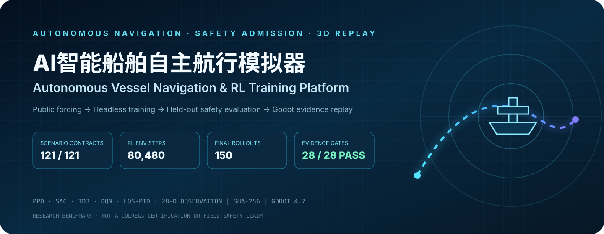

<p align="center">
  
</p>

<p align="center">
  <a href="https://github.com/wenjiayi123/sailing-simulator/actions/workflows/rl-tests.yml"></a>
  <a href="LICENSE"></a>
  
  
  
  
</p>

<p align="center">
  <strong>不是“船在场景里会动”，而是一套可训练、可拒绝、可回放、可追溯的自主航行策略准入实验台。</strong><br />
  <em>Not merely a moving vessel—a trainable, rejectable, replayable, and traceable admission bench for autonomous-navigation policies.</em>
</p>

<p align="center">
  <a href="#系统价值--engineering-value">系统价值</a> ·
  <a href="#五种统一基线--five-comparable-baselines">算法矩阵</a> ·
  <a href="#固定公开海况可靠性基准--public-forcing-reliability-benchmark">可靠性基准</a> ·
  <a href="#训练与渲染边界--training--rendering-boundary">训练边界</a> ·
  <a href="#快速开始--quick-start">快速开始</a> ·
  <a href="reports/simulator_reliability_audit_v1.md">证据报告</a>
</p>

---

## 系统价值 / Engineering value

Godot 4.7 负责船舶操控、港区环境、风险包络和三维证据回放；Python/Gymnasium 负责时间隔离数据集、无渲染训练、模型固化、独立测试和策略准入。训练进度直接来自 Stable-Baselines3 的实际 `num_timesteps`，测试轨迹只由训练完成后的封存 `test` rollout 生成；失败、碰撞、近失和越界不会被演示层改写。

Godot 4.7 owns vessel control, port geometry, risk envelopes, and 3D evidence replay. Python and Gymnasium own chronological data isolation, headless learning, model persistence, independent evaluation, and policy admission. Training progress comes from actual Stable-Baselines3 timesteps, while visual replay is generated only from sealed post-training test rollouts.

| 可核验维度 / Verifiable dimension | 固定证据 / Pinned evidence | 工程意义 / Why it matters |
|---|---:|---|
| 场景合同 / Scenario contracts | **121/121** 完整 | 航线、障碍、地形、动态船与风浪流字段可逐场检查 |
| 训练执行 / Training execution | **80,480** RL环境步、**167** episodes | 真实 learner 路径，不用计时器模拟进度 |
| 独立评测 / Independent evaluation | **155** validation + **150** final rollouts | 训练、选型与最终测试严格分离 |
| 回放一致性 / Replay consistency | **5/5** 回放、**1,723** 采样点 | 后端指标、逐场CSV与Godot轨迹相互校验 |
| 证据门禁 / Evidence gate | **28/28** 检查通过 | 数据、奖励、模型、轨迹与源码哈希绑定 |
| 安全准入 / Safety admission | 五方法均被保守门禁拒绝 | 证明系统会暴露安全裕度缺口，而非美化零碰撞 |

> [!IMPORTANT]
> 当前证据证明的是仿真平台完整性、算法评测能力和失效安全门禁，不是实船海试、COLREGs认证或商业航行许可。公开环境强迫、仿真动力学与真实传感/执行数据始终分层标注。

## 五种统一基线 / Five comparable baselines

| 基线 | 动作空间 | 实现 |
|---|---|---|
| PPO | 连续油门 + 舵角 | Stable-Baselines3 |
| SAC | 连续油门 + 舵角 | Stable-Baselines3 |
| TD3 | 连续油门 + 舵角 | Stable-Baselines3 |
| DQN | 9 个离散油门/舵角组合 | Stable-Baselines3 |
| LOS-PID | 连续油门 + 舵角 | 视线制导 + PID 控制理论基线 |

DQN 只使用离散动作，因为标准 DQN 本身不支持连续动作。四种 RL 与 LOS-PID 使用同一观测定义、动力学、奖励/安全指标和数据集切分，便于做可复现实验。

数值环境不是二维圆点演示：训练会计算圆形、矩形和多边形障碍，区分悬岩/岸线的额外安全净距，推进动态交通船，并把闭合速度、TCPA/DCPA、动态目标标识、边界净距、前/左/右扇区净距及风浪流相对方向纳入 28 维观测。风、浪、流均实际进入状态转移；当前 Godot 场景中的 `落水悬岩`、导航岩石和临时港区障碍可随训练配置一起合并。

## 固定公开海况可靠性基准 / Public-forcing reliability benchmark

本项目以模拟器的功能闭环和可靠性为评价对象，不把离线仿真结果包装成港口降本、增收或实船安全收益。

- 环境输入：Open-Meteo 长滩邻近水域 2024-01-01 至 2024-04-30 共 2,904 条小时级再分析/模式归档，派生 121 个日级场景。
- 时间隔离：1—2 月 60 场训练、3 月 31 场验证、4 月 30 场最终测试；不随机打乱日期。
- 训练预算：PPO、SAC、TD3、DQN 各设置 20,000 timestep，LOS-PID 为同环境控制理论基线。
- 最终验证：五方法共 150 个方法-场景 rollout。SAC 与 LOS-PID 在各自 30 场测试中实现 100% **无碰撞到达**且碰撞场景率为 0；SAC 平均/P95 最大横向航迹误差为 9.98/15.13 m，但 P05 最小净距仅 0.99 m。
- 安全语义：旧字段 `safe_completion_rate` 不排除近失事件，因此只能解释为“无碰撞到达率”。当前五方法在 32 m 风险包络下均触发过包络侵入，保守离线策略准入门禁拒绝全部方法，不把零碰撞包装成安全认证。
- 工程验收：121/121 场景契约完整，150/150 逐场记录齐全，28/28 项哈希与指标一致性检查、5/5 份代表性 Godot 回放（1,723 个采样点）及 Godot 4.7 解析/短时 headless 启动 2/2 通过。
- 证据边界：海况来自公开数值产品，航线、障碍、船舶动力学和动作响应来自项目仿真设定；结果不是实船海试、避碰认证或 COLREGs 合规结论。

完整方法、逐算法结果、哈希和边界见 [模拟器可靠性审计](reports/simulator_reliability_audit_v1.md)、[机器可读审计](reports/simulator_reliability_audit_v1.json) 与 [五方法原始基准](reports/navigation_benchmark_v1.json)。

## 训练与渲染边界 / Training & rendering boundary

```text
train split -> Python 数值环境 -> 真实训练 -> checkpoint
                                                   |
用户点击“运行测试集并渲染”                         v
test split  -> Python 确定性 rollout -> 真实轨迹/指标 -> Godot 3D 回放
```

- 训练进程不启动 Godot 场景渲染。
- 训练阶段只实例化 `train` split。
- checkpoint 同时记录数据集和完整实验配置 SHA-256；训练后数据、船体动力、奖励或环境安全设置被替换时，测试会拒绝运行。
- 测试失败、碰撞、超时和航线误差不会被改写。
- Godot 回放使用测试 rollout 记录的油门/舵角序列，而不是内置演示路线。

## 快速开始 / Quick start

安装 Python 训练环境：

```bash
cd /path/to/sailing-simulator
bash tools/setup_rl_env.sh
```

默认开发、测试和 CI 使用 `requirements-rl.txt`。只有对仓库自带、SHA-256
校验通过的历史模型进行字节级深度复算时，才使用报告保存的旧环境记录：

```bash
.venv/bin/python -m pip install -r reports/navigation_benchmark_runtime_legacy.lock
```

旧环境记录不是默认运行依赖，不应用于加载外部或未经哈希校验的模型文件。

运行测试：

```bash
make test
make benchmark-verify
make reliability-audit
make release-check
```

GitHub Actions 会在 push 和 pull request 上运行环境契约、split 隔离、LOS-PID 闭环、AIS 转换、公开数据完整性、实验哈希和报告一致性检查。贡献数据或算法前请阅读 [CONTRIBUTING.md](CONTRIBUTING.md)。

打开 Godot：

```bash
/path/to/Godot --editor --path /path/to/sailing-simulator
```

运行主场景后按 `C` 打开训练页。“算法/环境设置”可配置船体半径、悬岩净距、感知范围、碰撞时间窗、域随机化和生成交通船；“预览安全边界”会把有效包络直接画回场景。选择算法和预算后点击“启动训练”，完成后再点击“运行测试集并渲染”。

## 命令行训练

```bash
.venv/bin/python tools/rl_train_baselines.py \
  --mode train \
  --algorithm ppo \
  --config tests/fixtures/ship_training_config.json \
  --episodes 25 \
  --steps 800 \
  --agents 1 \
  --output-dir output/rl_runs \
  --progress-json output/rl_runs/training_progress.json \
  --checkpoint-json output/rl_runs/policy_checkpoint.json
```

训练后独立测试：

```bash
.venv/bin/python tools/rl_train_baselines.py \
  --mode evaluate \
  --algorithm ppo \
  --config tests/fixtures/ship_training_config.json \
  --steps 800 \
  --eval-episodes 1 \
  --output-dir output/rl_runs \
  --progress-json output/rl_runs/evaluation_progress.json \
  --checkpoint-json output/rl_runs/policy_checkpoint.json \
  --trajectory-json output/rl_runs/policy_test_trajectory.json
```

固定基准的复现入口：

```bash
# 离线使用仓库内已固化的 2,904 条小时数据重建 121 个场景
.venv/bin/python tools/build_public_navigation_benchmark.py

# 快速校验数据、配置、代码、模型和测试轨迹哈希
.venv/bin/python tools/run_navigation_benchmark.py verify

# 重新执行五方法共 150 个确定性 test rollout
.venv/bin/python tools/run_navigation_benchmark.py verify --deep
```

## 接入真实港口

项目接受包含 `train`、`validation`、`test` 的 `ship_port_dataset_v2` JSON。只需把环境变量指向新数据集，无需修改算法代码：

```bash
export SHIP_RL_DATASET=/absolute/path/to/port_training_dataset.json
```

NOAA/BOEM AccessAIS CSV 或 ZIP 可直接规范化：

```bash
python3 tools/public_data_pipeline.py ais \
  --input /path/to/AccessAIS-export.zip \
  --origin-lat 33.73 \
  --origin-lon -118.27 \
  --bbox -118.35 33.68 -118.15 33.82 \
  --environment-geojson /path/to/port_environment.geojson \
  --dataset-output /path/to/port_training_dataset.json \
  --targets-output /path/to/ais_targets.json
```

AIS 态势面板读取：

```bash
export SHIP_AIS_TARGETS=/absolute/path/to/ais_targets.json
```

AIS 提供历史航迹，GeoJSON 提供岸线、悬岩、礁石、码头和防波堤；二者会投影到同一个局部米制坐标系。港口场景配置可通过 `SHIP_PORT_PROFILE` 或 `user://port_profile.json` 替换。RL 测试回放直接读取测试任务中的航线、地形、静态障碍和动态交通，因此换训练集/测试集即可更换算法实验水域。

## 公开海况数据

默认启动会读取仓库内带来源元数据的 Open-Meteo 新加坡水域快照，并异步刷新实时公开数据。气象面板会显示 `live`、`cache`、`manual` 等真实来源状态；点击天气预设或手动改数值后，来源会明确变成 `scenario_override`/`manual_override`。

固定可靠性基准则使用长滩邻近水域 2024 年 1—4 月归档数据，不依赖启动时的网络状态。`data/public/*.provenance.json` 保留请求 URL、许可、抓取时间和小时 CSV SHA-256。Open-Meteo 的数值产品只作为离线环境强迫，不用于实际沿海导航。

也可离线更新缓存：

```bash
python3 tools/public_data_pipeline.py weather \
  --latitude 1.2644 \
  --longitude 103.8223 \
  --output data/public_cache/marine_weather_singapore.json
```

## 关键目录

- `tools/ship_rl/`：Gymnasium 环境、五基线训练和测试。
- `tools/rl_train_baselines.py`：Godot 与命令行共用入口。
- `data/rl/long_beach_public_weather_benchmark_v1.json`：固定公开海况可靠性基准，明确区分公开环境输入与仿真场景。
- `data/rl/default_port_dataset.json`：安装级项目原生 smoke fixture，不冒充实测 AIS。
- `tools/public_data_pipeline.py`：公开气象和 NOAA AIS 数据适配器。
- `tools/run_navigation_benchmark.py`：五方法准备、冻结测试集、最终测试和深度复核。
- `tools/run_simulator_reliability_audit.py`：场景覆盖、逐场指标、回放一致性、证据完整性和控制策略准入双门禁。
- `tools/run_godot_acceptance.py`：Godot 版本、解析和短时 headless 启动验收，回执绑定脚本/场景源文件树。
- `tools/release_check.py`：数据、模型、轨迹、报告和开源边界门禁。
- `scripts/ui/ship_rl_control_panel.gd`：真实训练/测试任务控制台。
- `scripts/rl/ship_policy_replay_controller.gd`：测试动作序列可视化回放。
- `docs/DATASET_SCHEMA.md`：数据契约与港口接入说明。
- `docs/PORT_PROFILE_SCHEMA.md`：Godot 港口场景与航行任务配置。
- `docs/MODULE_DATA_DRIVERS.md`：每个面板的数据源、计算边界和替换入口。
- `docs/ALGORITHM_PARAMETERS.md`：训练面板参数到五种基线后端的实际映射。
- `docs/LEGACY_ASSET_COMPATIBILITY.md`：旧场景/资源路径的保留边界与航行模拟器命名规则。

## 开源发布前检查

代码使用 Apache-2.0。运行 `make release-check` 可验证代码/数据/实验/模型证据；运行 `.venv/bin/python tools/release_check.py --strict-assets` 会把未解决的素材许可也作为失败项。现有图片、纹理和角色素材尚未全部完成来源核验，因此完整视觉包公开前仍必须处理 [资产许可审计](docs/ASSET_LICENSE_AUDIT.md)。公开数据的来源与署名要求见 [数据来源](docs/DATA_SOURCES.md)，评价口径见 [模拟器指标体系](docs/SIMULATOR_METRICS.md)，可对外表述见 [简历证据与禁用口径](docs/RESUME_CLAIMS.md)。
