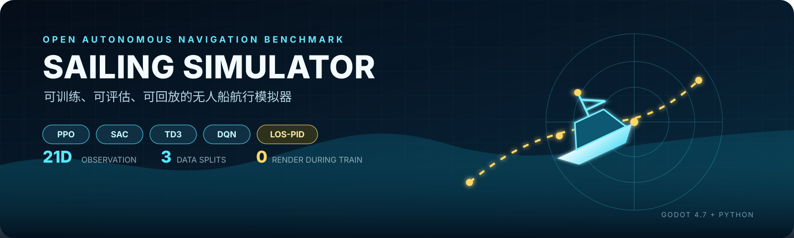
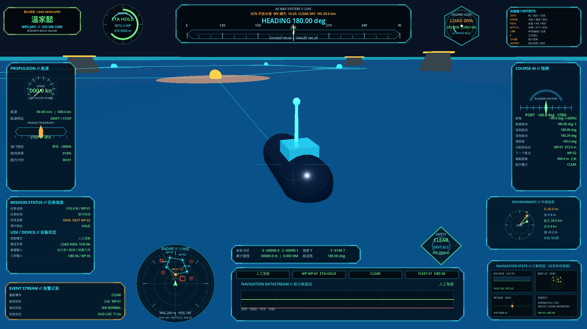
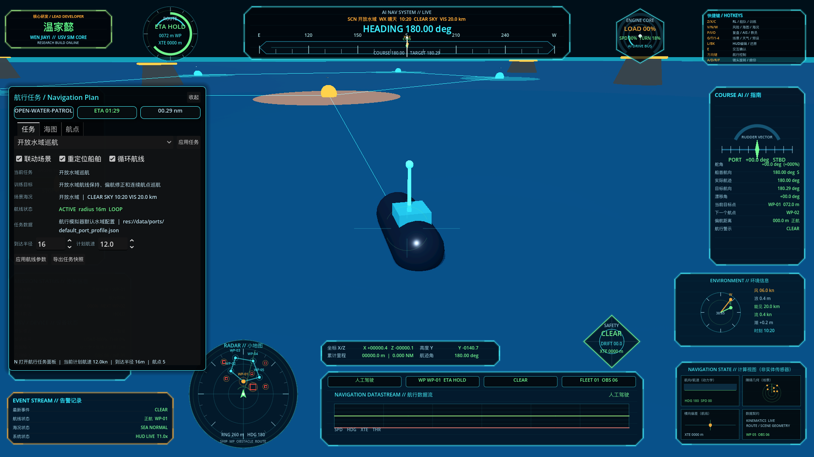
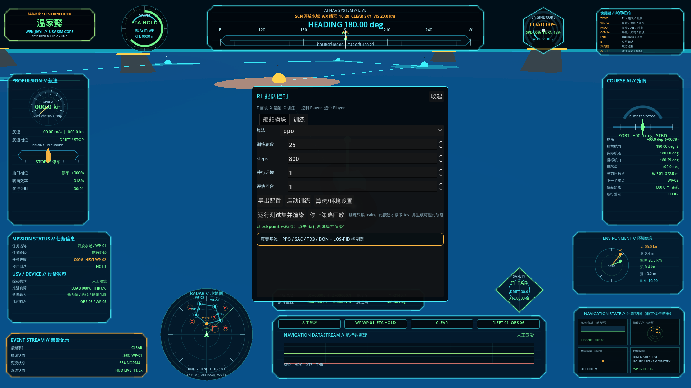
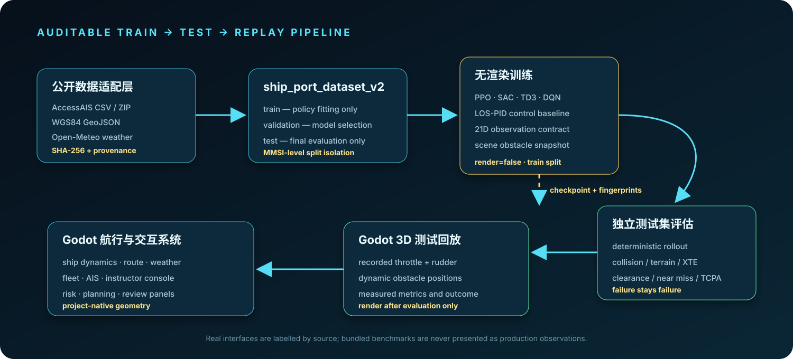

<div align="center">
  
  <h1>Sailing Simulator</h1>
  <p><strong>An auditable Godot + Python benchmark for autonomous-vessel simulation, interchangeable port data, and reproducible control experiments.</strong></p>
  <p>
    <a href="README.md">简体中文</a> ·
    <a href="docs/RL_DATA_TRAINING_POLICY_REPLAY_GUIDE.md">Experiment guide</a> ·
    <a href="docs/DATASET_SCHEMA.md">Data contract</a> ·
    <a href="CONTRIBUTING.md">Contributing</a>
  </p>
  <p>
    
    
    
    
  </p>
</div>

> [!WARNING]
> This repository is for research, education, and software validation. It is not a certified navigation, collision-avoidance, or vessel-control system and must not be used for real-vessel decisions.

## What it is

Sailing Simulator connects an interactive Godot 4.7 vessel scene to a Python experiment pipeline. Godot owns vessel control, procedural environments, traffic, route planning, telemetry, and recorded test playback. Python owns split isolation, render-free training, checkpoints, deterministic held-out evaluation, and machine-readable artifacts.

| Capability | Implementation |
|---|---|
| Interactive simulator | Procedural water and vessel, harbor obstacles, aids to navigation, weather, AIS targets, bilingual telemetry HUD |
| Five comparable baselines | PPO, SAC, TD3, DQN, and a control-theory LOS-PID baseline |
| Strict experiment boundary | Training reads `train`; evaluation reads `test`; training never renders the Godot scene |
| Interchangeable ports | `ship_port_dataset_v2`, port profiles, AIS and GeoJSON adapters |
| Auditable artifacts | Dataset/config SHA-256, checkpoint, real progress, held-out trajectory, and unmodified metrics |

## Real runtime captures



<details>
<summary><strong>Route planning and port profile</strong></summary>



</details>

<details>
<summary><strong>Training and evaluation console</strong></summary>



</details>

The PNG files above are generated from the current `main.tscn` by [`tools/capture_readme_screenshots.gd`](tools/capture_readme_screenshots.gd). They are runtime captures, not concept art.

## Evidence boundary

- Stable-Baselines3 `num_timesteps` is the source of training progress; there is no timer-based progress animation.
- The training process only instantiates the `train` split and does not launch Godot rendering.
- Checkpoints record SHA-256 fingerprints of the dataset and full experiment configuration.
- Evaluation performs deterministic rollouts on `test`. Failures, collisions, timeouts, and route errors are preserved.
- Godot replays the recorded throttle/rudder sequence produced by evaluation; it does not substitute a built-in success path.

> [!NOTE]
> The bundled dataset is a project-authored numerical benchmark for reproducibility. It is not measured AIS, hydrographic, or production-port data. Public-data adapters and bundled benchmark data are labeled separately.

## Architecture



The numerical environment supports circular, rectangular, and polygonal hazards, coastline safety margins, dynamic traffic, closing speed, TCPA, boundary clearance, and forward/port/starboard sector clearances in a 21-dimensional observation contract.

## Baselines

| Baseline | Action space | Backend |
|---|---|---|
| PPO | Continuous throttle + rudder | Stable-Baselines3 |
| SAC | Continuous throttle + rudder | Stable-Baselines3 |
| TD3 | Continuous throttle + rudder | Stable-Baselines3 |
| DQN | 9 discrete throttle/rudder combinations | Stable-Baselines3 |
| LOS-PID | Continuous throttle + rudder | Native guidance and PID controller |

All five baselines share the same observation, dynamics, safety metrics, and data splits. DQN is intentionally discrete because standard DQN does not support continuous actions.

## Quick start

Requirements: Godot 4.7 and Python 3.10+.

```bash
git clone https://github.com/wenjiayi123/sailing-simulator.git
cd sailing-simulator
bash tools/setup_rl_env.sh
.venv/bin/python -m unittest tests.test_ship_rl -v
godot --editor --path .
```

Run `main.tscn`. Press `C` to open the training tab, choose a baseline and budget, start training, then run the held-out test and replay it only after the checkpoint is ready.

Useful keys: arrow keys control throttle/rudder; right-drag and wheel control the camera; `G` changes the scenario; `T` and `1`–`4` control weather; `N`, `I`, `V`, `P`, and `O` open route, AIS, risk, review, and instructor panels.

## CLI experiment

```bash
.venv/bin/python tools/rl_train_baselines.py \
  --mode train \
  --algorithm ppo \
  --config tests/fixtures/ship_training_config.json \
  --episodes 25 --steps 800 --agents 1 \
  --output-dir output/rl_runs \
  --progress-json output/rl_runs/training_progress.json \
  --checkpoint-json output/rl_runs/policy_checkpoint.json
```

```bash
.venv/bin/python tools/rl_train_baselines.py \
  --mode evaluate \
  --algorithm ppo \
  --config tests/fixtures/ship_training_config.json \
  --steps 800 --eval-episodes 1 \
  --output-dir output/rl_runs \
  --progress-json output/rl_runs/evaluation_progress.json \
  --checkpoint-json output/rl_runs/policy_checkpoint.json \
  --trajectory-json output/rl_runs/policy_test_trajectory.json
```

A short smoke budget proves pipeline closure, not policy convergence. See [REPRODUCIBILITY.md](docs/REPRODUCIBILITY.md) for the artifact and reporting contract.

## Bring your own port

Point the stable `ship_port_dataset_v2` contract at another dataset without changing algorithm code:

```bash
export SHIP_RL_DATASET=/absolute/path/to/port_training_dataset.json
export SHIP_AIS_TARGETS=/absolute/path/to/ais_targets.json
export SHIP_PORT_PROFILE=/absolute/path/to/port_profile.json
```

`tools/public_data_pipeline.py` can normalize NOAA/BOEM AccessAIS CSV/ZIP data and GeoJSON environment geometry into the local metric frame. AIS supplies historical traffic tracks; GeoJSON supplies coastline and fixed hazards. See [DATASET_SCHEMA.md](docs/DATASET_SCHEMA.md), [PORT_PROFILE_SCHEMA.md](docs/PORT_PROFILE_SCHEMA.md), and [DATA_SOURCES.md](docs/DATA_SOURCES.md).

## Quality and limitations

CI checks data contracts, split isolation, dynamics, LOS-PID closure, and AIS conversion. The model is intended for algorithm and pipeline research; it is not a calibrated six-degree-of-freedom hydrodynamic model. Bundled traffic and geometry are project-authored benchmark inputs. Short CI runs do not establish convergence or rank algorithms.

Run the local gates with:

```bash
make test
make godot-check
```

See [ROADMAP.md](docs/ROADMAP.md), [RELEASE_CHECKLIST.md](RELEASE_CHECKLIST.md), and [project_structure.md](docs/project_structure.md) for scope and status.

## Community, security, and license

Please read [CONTRIBUTING.md](CONTRIBUTING.md), [CODE_OF_CONDUCT.md](CODE_OF_CONDUCT.md), and [SUPPORT.md](SUPPORT.md) before opening a contribution. Report security issues privately as described in [SECURITY.md](SECURITY.md).

Project-authored source, procedural scenes, documentation, and graphics are licensed under [Apache-2.0](LICENSE). Third-party runtime and public-data notices are listed in [THIRD_PARTY_ASSETS.md](docs/THIRD_PARTY_ASSETS.md) and [NOTICE](NOTICE). Use [`CITATION.cff`](CITATION.cff) when citing the project.
