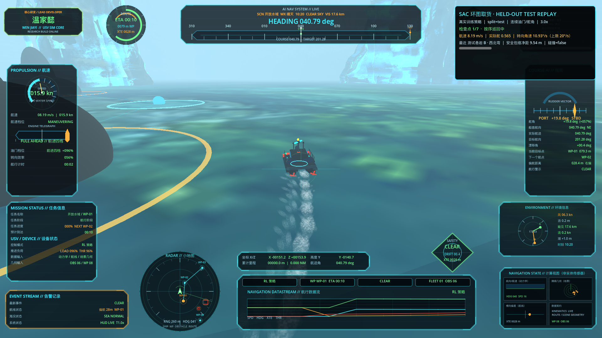
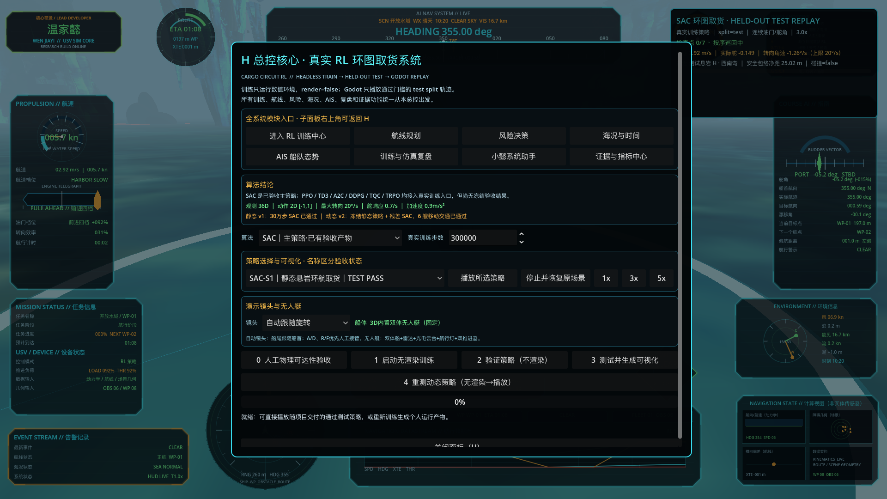
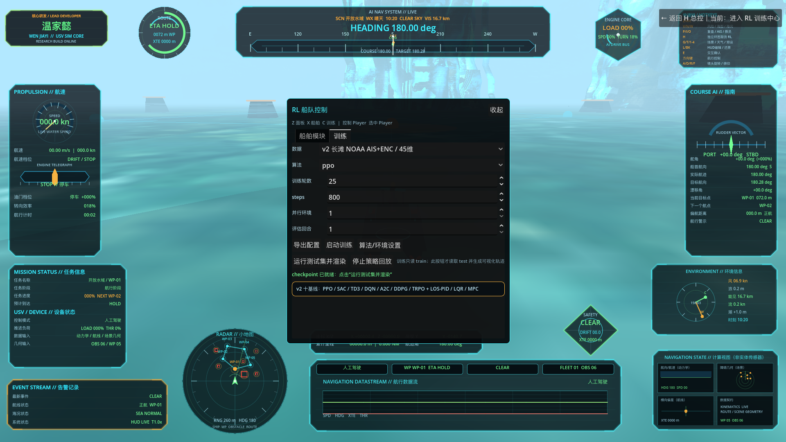

# H 总控核心与独立环图取货 RL

按 `H` 打开全系统总控核心。原 RL 训练面板、航线、风险、海况、AIS、复盘、小懿和证据中心现在全部从 H 进入；子面板右上角始终提供“返回 H 总控”。既有模型、训练产物和回放证据保持不变。Python 只做无渲染训练/验证/测试，Godot 只回放已经通过严格 test 门槛的轨迹。

## 算法选择

- 静态基础策略：SAC。油门和舵角均是连续动作，SAC 可复用经验回放，并通过熵正则进行避障探索。
- 动态高阶策略：冻结已验收的静态 SAC，再训练 residual SAC 修正量。这样保留静态绕岩能力，同时用相对运动观测学习动态让路。
- 可训练算法：SAC、PPO、TD3、A2C、DDPG、TQC、TRPO，七者均连接真实 Stable-Baselines3 / SB3-Contrib 无渲染训练入口，并在当前 36D 观测、2D 连续动作环境中完成最小启动测试。
- 验收边界：只有静态 SAC v1 和动态 Residual SAC v2 带有随项目交付的冻结 `TEST PASS` 产物；PPO、TD3、A2C、DDPG、TQC、TRPO 当前仅代表“能够启动真实训练”，不能宣传为已经收敛或通过测试。
- LOS-PID 只作为非学习控制基线，不计作 RL 训练证据。

## 任务、观测、动作和动力学

路线包含 7 个稀疏有序检查点和返航取货站，检查点间距至少 140 m，末段至少 100 m。每个 split 有 8 个水面悬岩，train / validation / test 的位置、尺寸和海况分开。

静态观测是 36D：当前目标距离/方位、船速、实际油门/舵角、横向偏差、最近悬岩净距/方位、三向扇区净距、流/风/浪、航点进度、下一航点距离/方位、下一弯转角、当前角速度、制动距离和转弯半径裕量。

动态观测是 44D：在静态 36D 上增加最近动态目标的相对纵/横位置、相对纵/横速度、闭合速度、TCPA 和 DCPA 等专用运动特征。每个动态任务有 6 艘显式移动交通船；训练位置/尺度可随机化，validation / test 固定且未参与训练。

动作是二维连续向量 `[油门, 舵角] ∈ [-1, 1]²`：

- 油门映射到 `[-0.35, 1.0]`，保留倒车制动；舵角映射到 `[-1.0, 1.0]`；
- 最大前进/倒车速度 8.5 / 2.2 m/s；
- 加速/自然减速/制动 0.9 / 0.65 / 1.6 m/s²；
- 油门/舵响应 0.55 / 0.70 每秒；
- 最大转向角速度 20°/s，低速和倒车转向效率分别为 0.12 / 0.45。

状态转移还实际加入风、浪、流。奖励覆盖航点推进、航向和合理航速；惩罚覆盖悬岩/动态船/边界碰撞、安全距离侵入、预测会遇风险、越速、倒车、横向偏差、大舵角、动作突变和时间成本。检查点与取货站奖励只发放一次。

## 大型悬岩碰撞与演示路线

场景中的大型悬岩保留了根据可见网格生成的 `Walkable_Collision` 和 `Body_Collision`。发布审计会用静态与动态两条 test 轨迹逐段和水面高度上的岩石三角面求交，不用宽泛包围盒代替真实表面。由于 test 回放是不可变轨迹的插值可视化，不走常规 `move_and_slide()`，回放控制器现在还会在每段位移前对独立岩石碰撞层做双面射线检查；若真实穿过表面则立即阻止回放，不会继续把船传送进岩体。

经轨迹审计与演示画面复核，只移动 `GroundedPlate_01_BroadLandMass`、`GroundedPlate_04_WideBridgeSlab` 和 `GroundedPlate_07_AncientWallPlate` 三块已确认穿模的旧岩石，并为它们增加补充实心防穿碰撞。包括东侧 `GroundedPlate_06_TwistedButtressMesa` 在内的其他大岩石均保留原位，以展示策略的近距离绕行。本修复不重新训练、不改动策略或轨迹文件。审计证据保存在 `reports/large_rock_collision_audit_v1.json`。

H 面板的“镜头”下拉框提供两种真实运行模式：`自动跟随旋转`会让相机平滑移到船尾并始终朝向船首；`自由镜头（不跟随）`不会自动旋转。自动模式中，`A / D` 环绕和 `R / F` 俯仰键一旦有输入就立即人工接管；松开键盘 1.25 秒后自动恢复航向跟随。自由模式中键盘镜头不会被电脑夺回。两种模式可在策略播放中即时切换，停止回放时恢复进入演示前的相机状态。

主船外观统一为 Godot 内置网格程序化搭建的 3D 双体无人艇，不再提供原图片船渲染或外观切换。模型包含双体浮筒、中央甲板、防撞船首、太阳能板、旋转雷达、光电云台、GNSS 天线、红绿航行灯和双推进器；雷达、推进器、信标及船体横摇会按运行状态动画。双推进器转速由实际航速、油门和实际舵角共同驱动：航速越高转得越快，直航时左右等速，转弯时外侧加速、内侧减速，倒车推力时反向旋转；转速变化带平滑响应，不会突然跳变。该改动只替换可见外观，继续使用同一 `CharacterBody3D`、碰撞体、舵角、惯性、RL 动作和轨迹，因此不需要重新训练。



## 训练前人工可达性

人工可达性脚本使用人工绕岩点与人工舵令规律，在相同动力学、海况、碰撞膨胀和边界下遍历 train / validation / test。它只证明任务可完成，报告明确为 `learned=false`、`rl_evidence=false`；数据或实验哈希改变时会阻止 RL 训练。

- 静态门槛：5/5 成功，零碰撞，最小安全包络净距 8.53 m，最大转向角速度 7.90°/s。
- 动态门槛：5/5 成功，零碰撞，最小动态净距 3.15 m，最大转向角速度 7.90°/s。

## 冻结结果

| 策略 | 训练合同 | test 结果 | 最小净距 | 路径效率 | 用时 |
|---|---|---|---:|---:|---:|
| 静态 v1 | 36D SAC，300,000 timestep | 7/7 + 取货，零碰撞、零倒车 | 悬岩包络 2.48 m；边界 6.27 m | 0.9114 | 177.75 s |
| 动态 v2 | 冻结静态 SAC + 5 轮行为克隆初始化 + 500 timestep residual SAC | 7/7 + 取货，6 艘交通，零碰撞、零倒车 | 总体 3.05 m；动态 6.66 m；边界 3.28 m | 0.8955 | 173.75 s |

动态 v2 的 `500 timestep` 是静态 300,000 步策略之上的残差学习量，不能宣传成独立从零训练 300,000 步。行为克隆只初始化 actor 并预填经验回放；最终 test 不调用人工控制器，也没有旁路动作。

## 完整命令

首次安装：

```bash
cd /Users/apple/Desktop/航行模拟器
bash tools/setup_rl_env.sh
```

静态人工验收、训练、验证和测试：

```bash
PYTHONPATH=tools .venv/bin/python tools/cargo_rl_manual_feasibility.py

PYTHONPATH=tools .venv/bin/python tools/cargo_rl_train.py \
  --config data/rl/cargo_circuit_experiment_v1.json \
  --mode train --algorithm sac --total-timesteps 300000 --steps 2400 \
  --output-dir output/cargo_rl \
  --progress-json output/cargo_rl/progress.json \
  --checkpoint-json output/cargo_rl/cargo_policy_checkpoint.json

PYTHONPATH=tools .venv/bin/python tools/cargo_rl_train.py \
  --config data/rl/cargo_circuit_experiment_v1.json \
  --mode evaluate --algorithm sac --eval-split validation --eval-episodes 1 --steps 2400 \
  --output-dir output/cargo_rl \
  --progress-json output/cargo_rl/validation_progress.json \
  --checkpoint-json output/cargo_rl/cargo_policy_checkpoint.json \
  --trajectory-json output/cargo_rl/validation_trajectory.json

PYTHONPATH=tools .venv/bin/python tools/cargo_rl_train.py \
  --config data/rl/cargo_circuit_experiment_v1.json \
  --mode evaluate --algorithm sac --eval-split test --eval-episodes 1 --steps 2400 \
  --output-dir output/cargo_rl \
  --progress-json output/cargo_rl/test_progress.json \
  --checkpoint-json output/cargo_rl/cargo_policy_checkpoint.json \
  --trajectory-json output/cargo_rl/cargo_policy_test_trajectory.json \
  --evidence-json output/cargo_rl/cargo_circuit_rl_evidence.json
```

动态高阶人工验收、残差训练和测试：

```bash
PYTHONPATH=tools .venv/bin/python tools/cargo_dynamic_manual_feasibility.py

PYTHONPATH=tools .venv/bin/python tools/cargo_rl_train.py \
  --config data/rl/cargo_circuit_dynamic_experiment_v2.json \
  --mode train --algorithm sac --total-timesteps 500 --steps 2600 \
  --replay-buffer-size 20000 --warmup-steps 0 \
  --output-dir output/cargo_dynamic_rl \
  --progress-json output/cargo_dynamic_rl/progress.json \
  --checkpoint-json output/cargo_dynamic_rl/cargo_dynamic_policy_checkpoint.json

PYTHONPATH=tools .venv/bin/python tools/cargo_rl_train.py \
  --config data/rl/cargo_circuit_dynamic_experiment_v2.json \
  --mode evaluate --algorithm sac --eval-split test --eval-episodes 1 --steps 2600 \
  --output-dir output/cargo_dynamic_rl \
  --progress-json output/cargo_dynamic_rl/test_progress.json \
  --checkpoint-json output/cargo_dynamic_rl/cargo_dynamic_policy_checkpoint.json \
  --trajectory-json output/cargo_dynamic_rl/cargo_dynamic_policy_test_trajectory.json \
  --evidence-json output/cargo_dynamic_rl/cargo_dynamic_rl_evidence.json
```

启动 Godot：

```bash
/Applications/Godot.app/Contents/MacOS/Godot --path /Users/apple/Desktop/航行模拟器
```

## H 总控按钮

1. 八个模块入口：`进入 RL 训练中心`、`航线规划`、`风险决策`、`海况与时间`、`AIS 船队态势`、`训练与仿真复盘`、`小懿系统助手`、`证据与指标中心`。
2. 算法下拉：`SAC / PPO / TD3 / A2C / DDPG / TQC / TRPO`；SAC 标注已有验收产物，其余明确标注可训练。
3. 策略下拉：
   - `SAC-S1｜静态悬岩环航取货｜TEST PASS`
   - `RES-SAC-D2｜动态交通避障取货｜TEST PASS`
   - `MANUAL-F0｜人工物理可达性基线｜非 RL`
   - `PERSONAL-LATEST｜算法｜待 validation/test 或 TEST PASS｜运行批次`
4. `播放所选策略`：只播放策略下拉中选择且符合准入条件的策略；个人策略在 test 通过前不可选。
5. 镜头下拉：`自动跟随旋转` / `自由镜头（不跟随）`，播放中即时生效。
6. `0  人工物理可达性验收`：重新遍历三个 split，只证明物理可达。
7. `1  启动无渲染训练`：按所选算法和步数启动真实训练，新 checkpoint 进入 `PERSONAL-LATEST` 并标记待测试。
8. `2  验证策略（不渲染）`：读取 validation split，不开放回放准入。
9. `3  测试并生成可视化`：读取 test split；严格通过后把个人策略标记为 `TEST PASS` 并自动播放。
10. `4  重测动态策略（无渲染→播放）`：用冻结动态 checkpoint 重跑 test，通过后播放。
11. `停止并恢复原场景`、`1x / 3x / 5x`、`关闭面板（H）`。
12. 子面板浮动按钮 `← 返回 H 总控｜当前：模块名`：隐藏当前子面板并回到 H。

H 面板已经移除三个重复的独立播放按钮，统一改由“策略下拉 + 播放所选策略”驱动。船体固定显示 3D 双体无人艇，不再有图片外观入口。旧快捷键保留为故障备用入口，但演示主流程统一从 H 出发。





## 证据边界

- `train` 只读训练集且 `render=false`；
- `validation` 只调参与验收；
- `test` 只在模型冻结后确定性运行并写数值轨迹；
- Godot 只接受 `trained_rl=true`、`dataset_split=test`、`acceptance_gate.passed=true` 的 RL 轨迹；
- 这是项目原生数值仿真，不是实港、实船或生产部署证据。
